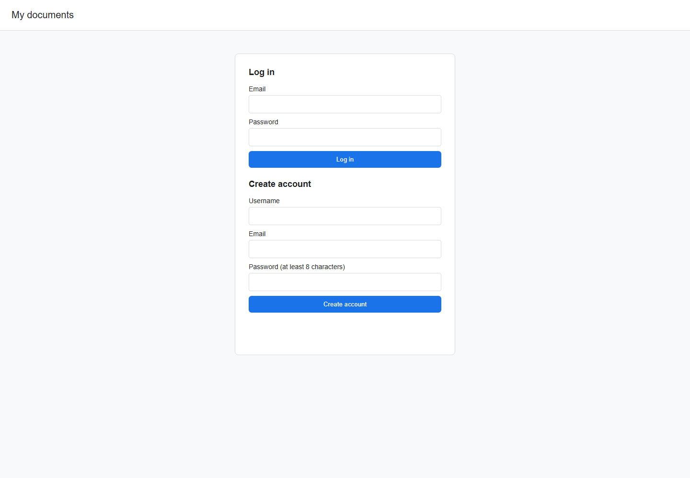

# Documents Mockup

A small Google Docs-style assignment project with accounts, document editing,
file import, and owner-managed sharing.

## Submission files

- [Submission contents](./SUBMISSION.md)
- [Architecture note](./ARCHITECTURE.md)
- [AI workflow note](./AI_WORKFLOW.md)
- [Walkthrough video URL](./WALKTHROUGH_VIDEO.txt) 

## Requirements

- Python 3.11 or newer
- PowerShell on Windows (or an equivalent terminal)
- Docker Desktop only if running the container

## Set up and run locally

From the project root:

```powershell
py -3 -m venv .venv
.\.venv\Scripts\Activate.ps1
python -m pip install -r app\dependencies.txt
python -m uvicorn app.main:app --reload
```

Open [http://127.0.0.1:8000](http://127.0.0.1:8000), register an account, and
create a document. The SQLite database is stored in `docsapp.db` in the project
root by default. To store it elsewhere, set `DOCSAPP_DATABASE_PATH` to an
absolute file path before starting the app.

The API schema is available at [http://127.0.0.1:8000/docs](http://127.0.0.1:8000/docs).

## Run tests

```powershell
.\.venv\Scripts\python.exe -m pytest -q
```

The tests cover account registration and login, document creation and editing,
rich-text persistence, file imports, sharing permissions, and reopening the app
against the same database.

## Run with Docker

```powershell
docker build -t documents-mockup .
docker volume create documents-data
docker run --rm -p 8000:8000 `
  -v documents-data:/var/data `
  -e DOCSAPP_DATABASE_PATH=/var/data/docsapp.db `
  -e DOCSAPP_COOKIE_SECURE=false `
  documents-mockup
```

The named volume keeps the SQLite database when the container is replaced.
`DOCSAPP_COOKIE_SECURE=false` is for local HTTP only; use secure cookies behind
HTTPS.

## Live product

The currently deployed product is available at:

[https://ajaia-s-assigment-submession-production.up.railway.app/](https://ajaia-s-assigment-submession-production.up.railway.app/)



The deployment uses the repository's Dockerfile. For durable SQLite data, the
Railway service should mount a persistent volume at `/var/data` and set
`DOCSAPP_DATABASE_PATH=/var/data/docsapp.db`. Set
`DOCSAPP_COOKIE_SECURE=true` when serving over HTTPS, and configure the service
health check to use `/health`. Keep the SQLite-backed service to one replica.

An optional Render Blueprint is also included in `render.yaml`.

See [ARCHITECTURE.md](./ARCHITECTURE.md) for the architecture summary.

This is an educational mockup, not a production identity or document service.
